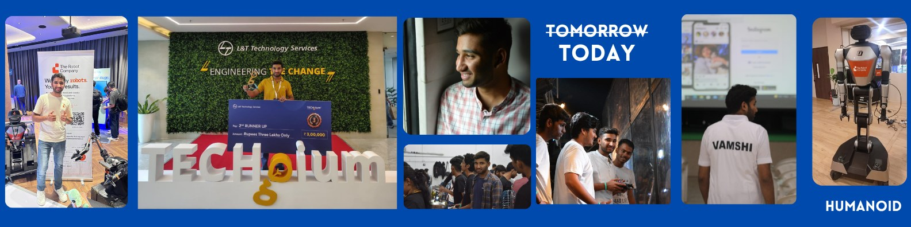

  

<h1 align="center">Bellam Vamshi Krishna</h1>

Founding Engineer at The Robot Company · Building robots for real-world deployments

    

## About

I build robots for real-world deployments as a founding engineer at [The Robot Company](https://www.therobotcompany.ai/).
Before that I worked across perception, control, embedded systems and hardware design, on agricultural robots and medical devices.
Electronics and Communication Engineering graduate.

## Experience

| Role | Company | Period |
|:--|:--|:--|
| **Founding Engineer** | The Robot Company | 2026&nbsp;‑&nbsp;Present |
| **Robotics Engineer** | Peepul Agri | Sep&nbsp;2025&nbsp;‑&nbsp;Dec&nbsp;2025 |
| **Embedded and Electrical Intern** | Cortex N Grey, IIT Hyderabad | Jan&nbsp;2025&nbsp;‑&nbsp;Jul&nbsp;2025 |
| **Product Design Intern** | Center for Health Care Entrepreneurship, IIT Hyderabad | Mar&nbsp;2024&nbsp;‑&nbsp;Sep&nbsp;2024 |

## Projects and Competitions

- **Battery digital twin** - L&T Techgium 2025, 2nd runner-up. LSTM state-of-charge prediction, 95% match between twin and hardware, and a mode that fuses real and simulated data.
- **Level-3 autonomous car** - NXP AIM 2024, finalist. LIDAR + camera fusion, lane following, YOLO sign recognition on NXP NavQ+ with ROS. [Simulation code](https://github.com/Vamshi430/NXP-CODES)
- **Smart fogponics** - TIH ATMAN 2.0, finalist. IoT mist-nutrient system with pH, TDS and humidity sensing, pitched at IIT Bombay.
- **Combat robot** - IIT Bombay Techfest 2023. Fusion 360 design, CNC-fabricated parts, RF + ESC wireless control.
- **ecelab.me** - practice platform for ECE students that I built and run. Its Linux terminal boots a real Buildroot kernel in the browser. [Source](https://github.com/Vamshi430/ecelab-linux-cli-buildroot)

## Tech Stack

<table>
  <tr>
    <td><b>Languages</b></td>
    <td>  </td>
  </tr>
  <tr>
    <td><b>Robotics</b></td>
    <td>    </td>
  </tr>
  <tr>
    <td><b>Teleop</b></td>
    <td>    </td>
  </tr>
  <tr>
    <td><b>Vision</b></td>
    <td>  </td>
  </tr>
  <tr>
    <td><b>Embedded & Edge</b></td>
    <td>    </td>
  </tr>
  <tr>
    <td><b>Hardware Design</b></td>
    <td>   </td>
  </tr>
  <tr>
    <td><b>Tools</b></td>
    <td>  </td>
  </tr>
</table>

